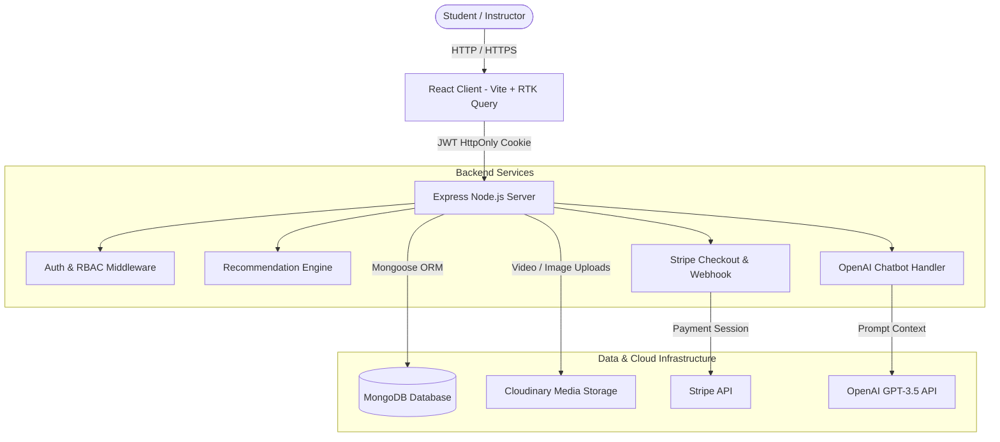

# 📚 Mero Pathsala - Full-Stack E-Learning & AI-Powered Course Platform
> **Comprehensive Technical Documentation & System Specifications**

---

## 📋 Executive Summary

**Mero Pathsala** is an advanced, full-stack educational web application designed to deliver personalized online learning experiences. Built using the **MERN stack** (MongoDB, Express.js, React.js, Node.js) with **Vite**, **Redux Toolkit (RTK Query)**, **Tailwind CSS**, **Stripe API**, **Cloudinary**, and **OpenAI GPT-3.5**, the platform provides:

- **Personalized Student Learning:** Content-based and collaborative recommendation systems tailored to student skills, career goals, experience levels, and learning history.
- **AI-Powered Learning Assistant:** Context-aware AI chatbot helping students navigate course offerings, track progress, and obtain learning recommendations.
- **Instructor Studio:** Full-featured course and lecture management dashboard for creating, uploading, managing, and publishing educational video content.
- **Secure Payment & Automated Enrollment:** Seamless course checkout powered by Stripe Checkout with webhook verification.
- **Adaptive Learning Player:** Interactive progress tracking, lecture completion toggles, and video playback with free preview options.

---

## 🛠️ Technology Stack

### **Frontend Infrastructure**
| Technology | Role / Usage |
| :--- | :--- |
| **React 18** | UI Library for modular component architecture |
| **Vite** | Modern, lightning-fast frontend build tool and dev server |
| **Redux Toolkit & RTK Query** | Centralized state management and declarative API query handling |
| **React Router DOM v6** | Client-side routing with protected route guards |
| **Tailwind CSS & Shadcn/Radix UI** | Modern design system, accessible UI primitives, dark/light mode support |
| **Framer Motion** | Micro-animations, page transitions, and multi-step modal animations |
| **Lucide React** | High-quality icon set |
| **React Player & React Quill** | HTML5 video player integration & rich-text editor for course descriptions |
| **Recharts** | Interactive charts and analytics visualizations for instructor dashboards |
| **Sonner** | Toast notifications |

### **Backend Infrastructure**
| Technology | Role / Usage |
| :--- | :--- |
| **Node.js & Express.js** | RESTful HTTP server framework with ES Module support |
| **MongoDB & Mongoose** | NoSQL database storing user profiles, course data, interactions, and analytics |
| **JSON Web Tokens (JWT) & bcryptjs** | Authentication token management via HttpOnly cookies and password hashing |
| **Multer & Cloudinary SDK** | Multipart form processing and media upload/hosting (thumbnails & video content) |
| **Stripe Node SDK** | Payment gateway session creation and webhook signature validation |
| **OpenAI API (GPT-3.5 Turbo)** | Natural language query processor for the platform's AI learning bot |
| **Cosine Similarity Math Engine** | Collaborative filtering vector math for user behavior analytics |

---

## 🏗️ System Architecture & Workflow



---

## 🗄️ Database Schemas & Data Models

### 1. **User Schema (`user.model.js`)**
Stores user metadata, credentials, role assignments, skills, educational background, and enrolled courses.
- **Fields:**
  - `name`: `String` (Required)
  - `email`: `String` (Required, Unique)
  - `password`: `String` (Hashed via bcrypt)
  - `role`: `String` (`student` | `instructor`, Default: `student`)
  - `skills`: `[String]`
  - `interests`: `[String]`
  - `experienceLevel`: `String` (`beginner` | `intermediate` | `advanced`)
  - `preferredRoles`: `[String]` (e.g., "Full Stack Developer", "Data Scientist")
  - `jobTitle`: `String`
  - `educationLevel`: `String`
  - `photoUrl`: `String`
  - `enrolledCourses`: `[ObjectId]` (References `Course`)

### 2. **Course Schema (`course.model.js`)**
Represents educational courses created by instructors.
- **Fields:**
  - `courseTitle`: `String` (Required)
  - `subTitle`: `String`
  - `description`: `String` (Rich HTML text)
  - `category`: `String` (Required)
  - `courseLevel`: `String` (`Beginner` | `Medium` | `Advance`)
  - `coursePrice`: `Number`
  - `courseThumbnail`: `String` (Cloudinary URL)
  - `isPublished`: `Boolean` (Default: `false`)
  - `tags`: `[String]`
  - `creator`: `ObjectId` (Ref `User`)
  - `lectures`: `[ObjectId]` (Ref `Lecture`)
  - `enrolledStudents`: `[ObjectId]` (Ref `User`)

### 3. **Lecture Schema (`lecture.model.js`)**
Represents individual video lessons within a course.
- **Fields:**
  - `lectureTitle`: `String` (Required)
  - `videoUrl`: `String` (Cloudinary streaming URL)
  - `publicId`: `String` (Cloudinary media asset ID)
  - `isPreviewFree`: `Boolean`

### 4. **Course Progress Schema (`courseProgress.js`)**
Tracks student completion state per lecture and course.
- **Fields:**
  - `userId`: `String`
  - `courseId`: `String`
  - `completed`: `Boolean`
  - `lectureProgress`: `[{ lectureId: String, viewed: Boolean }]`

### 5. **Course Purchase Schema (`coursePurchase.model.js`)**
Records transaction logs for paid courses.
- **Fields:**
  - `courseId`: `ObjectId` (Ref `Course`)
  - `userId`: `ObjectId` (Ref `User`)
  - `amount`: `Number`
  - `status`: `String` (`pending` | `completed` | `failed`)
  - `paymentId`: `String` (Stripe Session ID)

### 6. **Analytics & Interaction Schemas (`courseclick.model.js` & `UserCourseInteraction.model.js`)**
- Tracks student course clicks (`clickedAt`, `userId`, `courseId`) to feed the collaborative recommendation algorithm.

---

## ⚡ Core Features & Business Logic

### 1. **Authentication & Role-Based Access Control (RBAC)**
- Secure registration and login supporting dual roles (`student` and `instructor`).
- Tokens are transmitted securely via HttpOnly cookies.
- Route protection guards (`ProtectedRoute`, `AdminRoute`, `PurchaseCourseProtectedRoute`) prevent unauthorized access to student dashboards, course progress pages, and instructor backoffices.

### 2. **Multi-Step Student Personalization Onboarding**
- Upon initial sign-in, students are presented with an interactive, multi-step Framer Motion wizard (`MainLayout.jsx`).
- Collects student primary goals, target career roles, current skills, job titles, education levels, and experience.
- The captured data directly feeds into the recommendation engine to immediately personalize recommended courses.

### 3. **Smart Recommendation System**
The platform implements three distinct recommendation algorithms in `recommendation.controller.js` and `trending.course.controller.js`:

1. **Content-Based Recommendation (`recommendCourses`):**
   - Matches user profiles (skills, preferred roles, education level) against course metadata (`courseTitle`, `subTitle`, `tags`).
   - Applies weighted scoring:
     - Skill matching (80% weight) with synonym expansion (e.g., matching JS to React/Node).
     - Education level bonus (20% weight).
   - Provides fallback recommendations (top beginner courses) if zero direct matches are found.

2. **Collaborative Recommendation (`recommendCollaborativeCourses`):**
   - Analyzes peer behavior by weighting course purchases and course clicks across all platform users.
   - Formula: `TotalScore = (TotalClicks * 2) + TotalPurchases`.
   - Filters out courses already purchased by the active user.

3. **Trending Courses (`getTrendingCourses`):**
   - Uses MongoDB Aggregation pipelines to isolate published courses purchased by 2+ distinct users, sorted in descending order of total completed purchases.

### 4. **Course & Lecture Management (Instructor Studio)**
- Instructors can create new courses, edit descriptions with React Quill, select categories, assign difficulty levels, and set pricing.
- Image thumbnail uploads process via Multer and stream directly to Cloudinary.
- Lecture uploads accept video files, process them through Cloudinary, and allow instructors to toggle `isPreviewFree` for prospective buyers.
- Course status toggle allows instructors to draft courses before making them publicly published.

### 5. **Monetization & Stripe Integration**
- **Checkout Flow:** When a student clicks "Buy Course", a Stripe Checkout Session is generated (`createCheckoutSession`).
- **Webhook Processing:** Upon payment completion, the Stripe webhook (`stripeWebhook`) verifies the event payload signature, updates purchase status to `completed`, enrolls the user in `enrolledCourses`, and adds the user ID to the course's `enrolledStudents`.

### 6. **Context-Aware AI Learning Assistant**
- Integrated OpenAI GPT-3.5 API (`chatController.js`).
- Dynamic Context Aggregation: Reads the user's current enrolled courses, user skills, interest parameters, total platform courses, and course progress.
- Responds to student queries such as course recommendations, platform statistics, progress inquiries, and topic summaries.

---

## 🔌 API Endpoint Specifications

### **User Endpoints (`/api/v1/user`)**
| Method | Endpoint | Description | Auth Required |
| :--- | :--- | :--- | :--- |
| `POST` | `/register` | Register a new user | No |
| `POST` | `/login` | Authenticate user & set JWT cookie | No |
| `GET` | `/logout` | Clear auth cookie | No |
| `GET` | `/profile` | Fetch active user profile & enrolled courses | Yes |
| `PUT` | `/profile/update` | Update user profile, photo, skills, & goals | Yes |

### **Course Endpoints (`/api/v1/course`)**
| Method | Endpoint | Description | Auth Required |
| :--- | :--- | :--- | :--- |
| `GET` | `/published-courses` | Fetch all published courses | No |
| `GET` | `/search` | Search courses with query, categories & price sort | Yes |
| `GET` | `/recommend` | Get content-based personalized recommendations | Yes |
| `GET` | `/collaborative` | Get collaborative filter recommendations | No |
| `GET` | `/trending` | Fetch trending courses based on purchases | No |
| `POST` | `/` | Create a new course (Instructor) | Yes |
| `GET` | `/` | Get creator's created courses | Yes |
| `GET` | `/:courseId` | Get course by ID | Yes |
| `PUT` | `/:courseId` | Edit course metadata & thumbnail | Yes |
| `PATCH` | `/:courseId` | Toggle publish status | Yes |
| `POST` | `/:courseId/lecture` | Add a lecture to course | Yes |
| `GET` | `/:courseId/lecture` | Get lectures for a course | Yes |
| `POST` | `/:courseId/lecture/:lectureId` | Edit lecture details | Yes |
| `DELETE` | `/lecture/:lectureId` | Remove lecture & delete Cloudinary video | Yes |

### **Purchase Endpoints (`/api/v1/purchase`)**
| Method | Endpoint | Description | Auth Required |
| :--- | :--- | :--- | :--- |
| `POST` | `/checkout/create-checkout-session` | Initialize Stripe Checkout session | Yes |
| `POST` | `/webhook` | Stripe payment verification webhook | Raw Body |
| `GET` | `/course/:courseId/detail-with-status` | Fetch course details with purchase state | Yes |
| `GET` | `/` | Get all completed user purchases | Yes |

### **Progress Endpoints (`/api/v1/progress`)**
| Method | Endpoint | Description | Auth Required |
| :--- | :--- | :--- | :--- |
| `GET` | `/:courseId` | Get course completion progress | Yes |
| `POST` | `/:courseId/lecture/:lectureId/view` | Mark individual lecture viewed | Yes |
| `POST` | `/:courseId/complete` | Mark entire course completed | Yes |
| `POST` | `/:courseId/incomplete` | Reset course completion | Yes |

### **AI Assistant Endpoints (`/api/v1/ai`)**
| Method | Endpoint | Description | Auth Required |
| :--- | :--- | :--- | :--- |
| `POST` | `/chat` | Chat with AI learning assistant | Optional |

---

## 📁 Directory & File Structure

```
mero-pathsala/
├── client/                      # React Frontend Application (Vite)
│   ├── public/                  # Static assets
│   ├── src/
│   │   ├── app/                 # Redux store & root reducer configuration
│   │   │   ├── rootRedcuer.js
│   │   │   └── store.js
│   │   ├── components/          # Reusable UI primitives & global components
│   │   │   ├── ui/              # Shadcn UI primitives (dialog, input, button, etc.)
│   │   │   ├── Navbar.jsx       # Navigation header with search & profile controls
│   │   │   ├── Footer.jsx       # Platform footer
│   │   │   ├── ProtectedRoutes.jsx # Route authentication guards
│   │   │   ├── ThemeProvider.jsx # Light/Dark mode provider
│   │   │   └── ...
│   │   ├── features/            # Redux Toolkit Slices & RTK Query APIs
│   │   │   ├── api/             # authApi, courseApi, courseProgressApi, purchaseApi
│   │   │   └── authSlice.js
│   │   ├── layout/              # Core layout wrappers & multi-step onboarding modal
│   │   │   └── MainLayout.jsx
│   │   ├── pages/               # Application view screens
│   │   │   ├── admin/           # Instructor dashboard, course & lecture management
│   │   │   │   ├── course/      # AddCourse, EditCourse, CourseTable
│   │   │   │   └── lecture/     # CreateLecture, EditLecture
│   │   │   ├── student/         # Student view pages
│   │   │   │   ├── HeroSection.jsx
│   │   │   │   ├── Courses.jsx
│   │   │   │   ├── CourseDetail.jsx
│   │   │   │   ├── CourseProgress.jsx
│   │   │   │   ├── MyLearning.jsx
│   │   │   │   ├── Dashboard.jsx
│   │   │   │   └── SearchPage.jsx
│   │   │   └── Login.jsx        # Login & Signup view
│   │   ├── App.jsx              # Router configuration & main entry layout
│   │   └── main.jsx             # React DOM root render
│   ├── package.json
│   ├── tailwind.config.js
│   └── vite.config.js
│
└── server/                      # Node.js & Express API Backend
    ├── controllers/             # Core business logic controllers
    │   ├── chatController.js           # OpenAI GPT-3.5 integration
    │   ├── course.controller.js         # Course & lecture CRUD
    │   ├── courseProgress.controller.js # Progress tracking logic
    │   ├── coursePurchase.controller.js # Stripe checkout & webhooks
    │   ├── recommendation.controller.js # Content-based & collaborative filtering
    │   ├── trending.course.controller.js # Aggregate purchase trends
    │   └── user.controller.js           # Auth & profile management
    ├── database/                # MongoDB connection handler (`db.js`)
    ├── middlewares/             # Auth validation (`isAuthenticated.js`)
    ├── models/                  # Mongoose data schemas
    │   ├── UserCourseInteraction.model.js
    │   ├── course.model.js
    │   ├── courseProgress.js
    │   ├── coursePurchase.model.js
    │   ├── courseclick.model.js
    │   ├── lecture.model.js
    │   └── user.model.js
    ├── routes/                  # Express route declarations
    │   ├── chat.route.js
    │   ├── course.route.js
    │   ├── courseProgress.route.js
    │   ├── media.route.js
    │   ├── purchaseCourse.route.js
    │   ├── recommendation.route.js
    │   └── user.route.js
    ├── utils/                   # Helper utilities (Cloudinary, Multer, JWT generator)
    ├── index.js                 # Express application entrypoint
    └── package.json
```

---

## ⚙️ Environment Variables & Setup Guide

### **Server Environment Configuration (`server/.env`)**
```env
PORT=8000
MONGO_URI=mongodb+srv://<username>:<password>@cluster.mongodb.net/meropathsala
SECRET_KEY=your_jwt_secret_key

# Cloudinary Storage Configuration
CLOUD_NAME=your_cloudinary_cloud_name
API_KEY=your_cloudinary_api_key
API_SECRET=your_cloudinary_api_secret

# Stripe Monetization
STRIPE_SECRET_KEY=sk_test_...
WEBHOOK_ENDPOINT_SECRET=whsec_...

# OpenAI AI Assistant
OPENAI_API_KEY=sk-proj-...
```

---

## 🚀 Running the Project Locally

### 1. **Start Backend Server**
```bash
cd server
npm install
npm run dev
# Server will run on http://localhost:8000
```

### 2. **Start Frontend Client**
```bash
cd client
npm install
npm run dev
# Client will run on http://localhost:5173
```

---

## 🎯 Key Highlights & Achievements
- ✅ **End-to-End MERN Stack Implementation** with modern ES Modules.
- ✅ **State-of-the-Art State Management** using RTK Query for automatic cache invalidation and loading states.
- ✅ **Multi-layered Recommendation Engine** incorporating content similarity, collaborative filtering, and trending metrics.
- ✅ **Production-Grade Monetization** featuring Stripe Checkout and webhook handling.
- ✅ **AI Assistant Integration** leveraging OpenAI GPT-3.5 with custom database context.
- ✅ **Polished UI/UX** with dark mode support, Framer Motion animations, and responsive Shadcn primitives.
